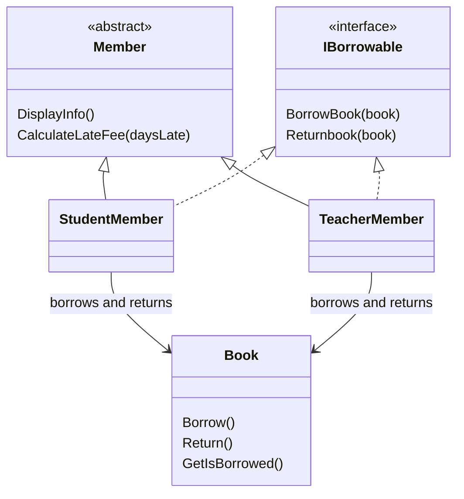

<div align="center">

# Library Management System

### A small borrowing workflow. A clear lesson in object-oriented design.

**C# · .NET 7 · Interfaces · Inheritance · Polymorphism**

</div>

[Overview](#overview) · [Design](#design) · [Run Locally](#run-locally) · [Example Scenario](#example-scenario)

## Overview

A console application demonstrating how **books, students, and teachers** can share a borrowing workflow while applying different late-fee rules. It is a compact learning project focused on encapsulation, an abstract member class, a borrowing interface, and overridden behavior.

The program creates two books and two members, performs borrowing and returns, checks book state, and prints fee calculations. Its state lives in memory for the duration of the demonstration.

<details>
<summary><strong>نبذة بالعربية</strong></summary>

تطبيق Console بلغة C# يشرح مفاهيم البرمجة الكائنية من خلال استعارة الكتب وإرجاعها. يشترك الطالب والمعلم في واجهة الاستعارة، ويحسب كل نوع غرامة التأخير بمعدل مختلف.

</details>

## Capabilities

| Component | Behavior |
|---|---|
| Book state | Tracks whether a book is currently borrowed |
| Borrow/return | Updates state and prints the action or an already-borrowed/not-borrowed message |
| Member information | Shared name/ID state and display behavior |
| Student fees | 0.5 JOD × days late |
| Teacher fees | 0.2 JOD × days late |

This version runs a predefined scenario. It does not include a menu, catalog search, persistent database, due-date scheduler, or loan ownership tracking.

## Design



- **Encapsulation:** Book keeps title, author, and borrowing state in private fields, exposed through methods.
- **Inheritance:** StudentMember and TeacherMember extend Member.
- **Abstraction:** Member defines the late-fee calculation contract.
- **Interface:** IBorrowable defines borrowing and return operations.
- **Polymorphism:** each member type overrides the late-fee calculation.

The source spelling `Returnbook` is retained in the method reference above.

## Run Locally

The project targets **`net7.0`**. Use an SDK/runtime compatible with that target, or explicitly retarget the project as a separate code change.

```bash
git clone https://github.com/ismailhalawa-ctrl/Library-Managment-System.git
cd Library-Managment-System
dotnet restore "Library Managment System/LibraryManagmentSystem.csproj"
dotnet run --project "Library Managment System/LibraryManagmentSystem.csproj"
```

The repository directory and project filenames retain their original spelling. Quote the path because it contains spaces. Visual Studio users can open the `.csproj` directly.

## Example Scenario

The committed Program.cs:

1. Creates the sample books **Clean Code** and **C# Basics**.
2. Creates teacher **Ahmad** and student **Khalid**.
3. Borrows one book for each member.
4. Prints the borrowed-state checks.
5. Returns the books and calculates late fees.

| Member | Late Days | Rate | Calculated Fee |
|---|---:|---:|---:|
| Student | 4 | 0.5 JOD/day | 2 JOD |
| Teacher | 3 | 0.2 JOD/day | 0.6 JOD |

Console wording and number formatting follow the current source and machine culture. Sample book metadata is demonstration data.

## Repository Guide

| Source | Responsibility |
|---|---|
| [Program.cs](Library%20Managment%20System/Program.cs) | Creates objects and runs the demonstration |
| [Book.cs](Library%20Managment%20System/Book.cs) | Book metadata and borrowing state |
| [Members.cs](Library%20Managment%20System/Members.cs) | Abstract Member definition |
| [IBorrowable.cs](Library%20Managment%20System/IBorrowable.cs) | Borrow/return contract |
| [StudentMember.cs](Library%20Managment%20System/StudentMember.cs) | Student operations and fee rule |
| [TeacherMember.cs](Library%20Managment%20System/TeacherMember.cs) | Teacher operations and fee rule |

## Development Notes

The book prevents changing its state twice in the same direction, but member methods still print their action message after calling it. A production borrowing service would need explicit success results, member/loan ownership, date validation, and persistence. Negative late-day values are not currently rejected.

Useful next steps include unit tests for fee calculations and state transitions, properties instead of duplicate member fields, and a menu-driven interface. This documentation update does not change the implementation.

---

Created by **[Ismail Halawa](https://github.com/ismailhalawa-ctrl)** · [Explore all projects](https://github.com/ismailhalawa-ctrl?tab=repositories)

